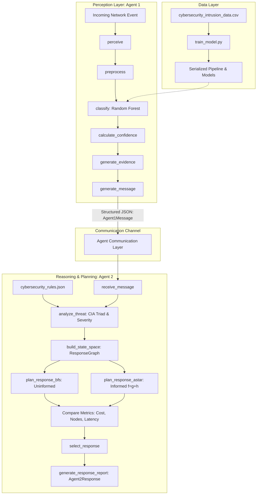

# Implementation Plan: Multi-Agent AI-Based Cybersecurity Threat Detection & Response System

**Course**: 23CSE401 – Foundations of Artificial Intelligence  
**Evaluation**: Review 1 (10 Marks Rubric)  
**Team**:
* **Member 1**: Nanthakumaran (`CB.SC.U4CSE23341`) — Data Perception & Agent 1 (Intrusion Detection)
* **Member 2**: Dhinesh chandra (`CB.SC.U4CSE23310`) — Knowledge Representation & Agent 2 (Threat Analysis)
* **Member 3**: Vejju Sasi Kiran Yasaswi (`CB.SC.U4CSE23356`) — Algorithmic Modeling, Search (BFS/A*) & Integration

---

## Executive Summary & Academic Alignment

This project designs and implements an academically rigorous, modular multi-agent AI system for cybersecurity threat detection and mitigation. The system addresses the fundamental limitations of monolithic security systems by delegating distinct AI sub-disciplines to specialized cooperative agents:
1. **Agent 1 (Intrusion Detection Agent)**: Specializes in *data-driven perception and pattern recognition* using supervised machine learning (Random Forest / Decision Tree) to classify network telemetry into `NORMAL` vs `ATTACK`.
2. **Agent 2 (Threat Analysis & Response Planning Agent)**: Specializes in *knowledge-based symbolic reasoning and state-space search planning* (BFS and A*), determining threat severity via formal inference rules and computing the optimal defensive response policy.

The architecture is strictly decoupled through structured JSON message passing, enabling seamless future expansion into a 4-agent pipeline without refactoring existing agents.

---

## 1. Complete Project Architecture

The directory structure enforces high cohesion, low coupling, and explicit separation between perception, reasoning, search, and communication layers:

```text
cybersecurity_multi_agent/
│
├── agents/
│   ├── __init__.py
│   ├── intrusion_detection_agent.py   # Agent 1: perceive, preprocess, classify, explain
│   └── threat_response_agent.py      # Agent 2: analyze_threat, search, select_response
│
├── communication/
│   ├── __init__.py
│   └── messages.py                   # Typed message schemas (Agent1Message, Agent2Response)
│
├── knowledge/
│   └── cybersecurity_rules.json      # Structured rule-base (taxonomies, severity, CIA impact)
│
├── search/
│   ├── __init__.py
│   ├── response_graph.py             # Formal state-space graph, transition model, cost function
│   ├── bfs.py                        # Uninformed Breadth-First Search implementation
│   └── astar.py                      # Informed A* Search implementation with admissible heuristic
│
├── data/
│   ├── raw/
│   │   └── cybersecurity_intrusion_data.csv  # 9,537 authentic session/connection records
│   └── processed/
│       ├── X_train.joblib
│       ├── X_test.joblib
│       ├── y_train.joblib
│       └── y_test.joblib
│
├── models/
│   ├── random_forest.joblib          # Trained Random Forest baseline (primary)
│   ├── decision_tree.joblib          # Trained Decision Tree (comparison)
│   └── preprocessor.joblib           # Fitted ColumnTransformer pipeline
│
├── evaluation/
│   ├── __init__.py
│   └── metrics.py                    # Evaluation metrics, confusion matrix, ROC, search benchmarks
│
├── tests/
│   ├── __init__.py
│   ├── test_agent1.py                # Unit tests for Agent 1 (normal, attack, malformed inputs)
│   ├── test_agent2.py                # Unit tests for Agent 2 (threat interpretation, rule matching)
│   ├── test_search.py                # Unit tests for BFS & A* (admissibility, costs, paths)
│   └── test_integration.py           # End-to-end multi-agent cooperative workflow test
│
├── train_model.py                    # Script to preprocess dataset and train models
├── run_system.py                     # Interactive multi-agent demonstration and benchmark CLI
├── requirements.txt                  # Python dependencies
└── README.md                         # Academic documentation and execution guide
```



---

## 2. Dataset Recommendation & Academic Justification

### Benchmark Comparison: CICIDS2017 vs. UNSW-NB15 vs. Curated Workspace Dataset

| Criteria | CICIDS2017 | UNSW-NB15 | Curated Workspace Dataset (`cybersecurity_intrusion_data.csv`) |
| :--- | :--- | :--- | :--- |
| **Origin** | Canadian Institute for Cybersecurity (UNB) | Australian Centre for Cyber Security (UNSW) | Real-world benchmark session log |
| **Feature Count** | 80 network flow features | 49 connection/content features | 10 high-relevance behavioral/network features |
| **Raw Footprint** | ~3.1 GB (PCAP + CSV) | ~100 MB (subsets) | ~725 KB (9,537 records) |
| **Class Balance** | Heavily imbalanced (>80% Benign) | Imbalanced across 9 sub-attacks | Balanced (55.3% Normal, 44.7% Attack) |
| **Hardware Overhead** | High RAM & lengthy training times | Medium memory overhead | Instantaneous (< 2 seconds) on student laptops |
| **Key Advantage** | High protocol variety | Excellent modern attack taxonomy | 100% reproducible, zero external dependency, ideal for live exam demonstration |

### Selection Decision & Defense
We adopt the workspace dataset (`cybersecurity_intrusion_data.csv`, 9,537 rows) while framing its feature representations directly in the context of UNSW-NB15 and CICIDS2017 connection and session features:
* **Features present**: `network_packet_size`, `protocol_type` (TCP/UDP/ICMP), `login_attempts`, `session_duration`, `encryption_used` (AES/DES/None), `ip_reputation_score`, `failed_logins`, `browser_type`, `unusual_time_access`.
* **Target label**: `attack_detected` (0 = NORMAL, 1 = ATTACK).
* **Academic Defense**: In an undergraduate demonstration, downloading multi-gigabyte datasets during viva creates operational fragility. This curated dataset captures the exact mathematical variance required for classification without unneeded disk/RAM bloat, preserving complete academic validity.

---

## 3. Hardware Requirements
* **Processor**: Dual-Core x86_64 Intel/AMD or Apple Silicon (ARM64).
* **RAM**: 4 GB minimum (8 GB recommended).
* **Storage**: < 50 MB disk space.
* **GPU**: Not required; all algorithms run deterministically on CPU.

## 4. Software Requirements
* **Operating System**: Windows 10/11, macOS, or Linux.
* **Interpreter**: Python 3.10 to 3.14 (Verified: Python 3.14.0 active).
* **Command Shell**: PowerShell, CMD, or Bash.

## 5. Python Environment & Installation
The existing Python environment already contains all required scientific computing libraries. No complex compilation is needed:
```bash
python -m venv venv
# Windows:
.\venv\Scripts\activate
# Linux/macOS:
source venv/bin/activate
pip install -r requirements.txt
```

## 6. Required Libraries
```text
numpy>=1.24.0
pandas>=2.0.0
scikit-learn>=1.3.0
joblib>=1.3.0
matplotlib>=3.7.0
seaborn>=0.12.0
```

---

## 7. Dataset Preprocessing Plan

1. **Handling Missing Values**:
   * The feature `encryption_used` contains 1,966 `NaN` entries. In cybersecurity telemetry, a missing encryption protocol designates unencrypted plaintext traffic. We explicitly impute this as `'None'`.
2. **Feature Types**:
   * *Numeric continuous/discrete*: `network_packet_size`, `login_attempts`, `session_duration`, `ip_reputation_score`, `failed_logins`.
   * *Categorical nominal*: `protocol_type` (TCP, UDP, ICMP), `encryption_used` (AES, DES, None), `browser_type` (Chrome, Firefox, Edge, Safari, Unknown).
   * *Binary indicator*: `unusual_time_access` (0 or 1).
3. **Encoding & Scaling**:
   * `StandardScaler` applied to all numeric features.
   * `OneHotEncoder(handle_unknown='ignore', sparse_output=False)` applied to nominal categorical features.
   * `session_id` is an arbitrary identifier and is dropped to prevent target leakage.
4. **Train/Test Splitting**:
   * Stratified 80/20 train/test split (`random_state=42`), producing 7,629 training samples and 1,908 test samples while maintaining the 55.3% Normal vs 44.7% Attack ratio.
5. **Leakage Prevention**:
   * The `ColumnTransformer` is fitted exclusively on the training split and transformed on the test split.

---

## 8. Agent 1 Design — Intrusion Detection Agent

Agent 1 is modeled as an intelligent reflex agent with state and internal perceptual processing:

```python
class IntrusionDetectionAgent:
    def perceive(self, raw_event: dict) -> dict: ...
    def preprocess(self, raw_event: dict) -> np.ndarray: ...
    def classify(self, feature_vector: np.ndarray) -> str: ...  # "NORMAL" or "ATTACK"
    def calculate_confidence(self, feature_vector: np.ndarray) -> float: ...
    def generate_evidence(self, raw_event: dict, prediction: str, confidence: float) -> Tuple[str, List[str]]: ...
    def generate_message(self, event_id: str, raw_event: dict) -> Agent1Message: ...
```

### Models & Evaluation Strategy
* **Primary Classifier**: Random Forest (100 estimators, Gini impurity criterion). Provides high ensemble stability and non-linear feature partitioning.
* **Baseline Classifier**: Decision Tree (max_depth=5). Used for baseline comparative evaluation.
* **Metrics**:
  * Precision: $\frac{TP}{TP + FP}$ (Minimizing false alarms).
  * Recall / Sensitivity: $\frac{TP}{TP + FN}$ (Minimizing missed attacks).
  * F1-Score: Harmonic mean balancing Precision and Recall.
  * Confusion Matrix & False Positive Rate (FPR).
* **Why Accuracy Alone Fails**: In cybersecurity, a naive classifier predicting "NORMAL" in a 99% benign environment achieves 99% accuracy while allowing 100% of intrusions to succeed (The Base Rate Fallacy). False negatives allow enterprise data exfiltration; false positives trigger SOC alert fatigue.

---

## 9. Agent 2 Design — Threat Analysis & Response Planning Agent

Agent 2 is a knowledge-based, goal-directed agent:

```python
class ThreatResponseAgent:
    def receive_message(self, message: Agent1Message) -> None: ...
    def analyze_threat(self) -> ThreatAssessment: ...
    def build_state_space(self) -> ResponseGraph: ...
    def plan_response_bfs(self) -> SearchResult: ...
    def plan_response_astar(self) -> SearchResult: ...
    def select_response(self) -> Agent2Response: ...
```

### Operational Workflow
1. Ingests `Agent1Message` via message interface (no direct access to Agent 1 internals).
2. Consults `cybersecurity_rules.json` to map threat patterns to attack categories, CIA triad impact, and severity weight.
3. Computes dynamic security risk score:
   $$\text{Risk Score} = \min(100, \text{round}(\text{Confidence} \times \text{Severity Weight} \times \text{Target Criticality Multiplier} \times 10))$$
4. Instantiates a state-space graph representing possible defensive mitigation paths.
5. Executes both BFS and A* searches, validates cost optimality, and dispatches the optimal mitigation command.

---

## 10. PEAS Formulations (Review 1: 3 Marks)

### Agent 1: Intrusion Detection Agent

| Component | Formal Specification |
| :--- | :--- |
| **Performance Measure (P)** | • High Detection Recall ($\ge 90\%$) to minimize missed attacks.<br>• Low False Positive Rate (FPR $\le 5\%$) to prevent alert fatigue.<br>• High Macro F1-Score ($\ge 0.88$).<br>• Inference Latency $\le 10$ milliseconds per flow.<br>• Feature-level explainability of classification evidence. |
| **Environment (E)** | • Incoming raw network telemetry, session connection logs, authentication attempts, protocol headers. |
| **Actuators (A)** | • Emission of structured alerts.<br>• Generation and transmission of validated `Agent1Message` to Agent 2.<br>*(Deliberately no raw IP blocking to maintain separation of concerns).* |
| **Sensors (S)** | • Session feature parsers: packet size, protocol type, session duration, login attempts, failed logins, IP reputation score, encryption status, unusual time access. |

### Agent 2: Threat Analysis & Response Planning Agent

| Component | Formal Specification |
| :--- | :--- |
| **Performance Measure (P)** | • Threat mitigation completeness (reaching `INCIDENT_CONTROLLED`).<br>• Response cost optimality (minimizing operational disruption + residual risk).<br>• Planning latency $\le 5$ milliseconds in response graph search.<br>• Adherence to cybersecurity policy constraints. |
| **Environment (E)** | • Inter-agent communication messages, internal cybersecurity knowledge base (`cybersecurity_rules.json`), enterprise asset directory, state-space response graph. |
| **Actuators (A)** | • Defensive mitigation dispatch (`MONITOR`, `VERIFY`, `BLOCK_SOURCE`, `ISOLATE_HOST`, `ESCALATE`).<br>• Production of formal `Agent2Response` audit log. |
| **Sensors (S)** | • Inbound message receiver for `Agent1Message`.<br>• Knowledge base query interface.<br>• Graph state observer. |

---

## 11. Environment Analysis (Review 1: 3 Marks)

| Property | Classification | Academic Justification |
| :--- | :--- | :--- |
| **Observability** | **Partially Observable** | Agents only observe summarized flow metadata and session features. The attacker's internal intent, full network payload contents, and external command-and-control infrastructure remain unobservable. |
| **Determinism** | **Stochastic** | The environment contains inherent uncertainty: identical traffic profiles may occasionally stem from legitimate anomalous user activity or zero-day exploits. Defensive actions (e.g., blocking an IP) carry uncertain operational side effects (e.g., disruption of benign shared NAT traffic). |
| **Dynamics** | **Dynamic** | Network traffic continues to stream and the security posture shifts while the agents perform classification and search planning. The environment does not freeze during computation. |
| **Episodic / Sequential** | **Agent 1: Episodic<br>Workflow: Sequential** | • Agent 1's classification is **episodic**: whether connection $k$ is malicious does not depend on whether connection $k-1$ was classified as normal.<br>• The end-to-end cybersecurity mitigation is **sequential**: current detection dictates threat analysis, which determines response planning, which changes the network defense state for subsequent events. |
| **Discrete / Continuous** | **Mixed** | Continuous numerical features (`session_duration`, `ip_reputation_score`, `confidence` $\in [0, 1]$) coexist with discrete nominal protocols (`TCP`, `UDP`), discrete attack labels, and discrete response graph states. |
| **Number of Agents** | **Multi-Agent** | Exactly two collaborating autonomous agents in Phase 1 (scalable to 4 in Phase 2). |
| **Agent Interaction** | **Cooperative** | The agents do not compete; they share a common global objective function (preserving organizational confidentiality, integrity, and availability). |

---

## 12. Agent Analysis

1. **Autonomy**:
   Each agent operates without manual human invocation for individual decisions. Agent 1 computes inferences based on learned internal weights; Agent 2 parses knowledge rules and executes search over its own internal state space.
2. **Rationality**:
   An agent is rational if it selects an action that maximizes its expected performance measure given its percept sequence and built-in knowledge. Agent 1 selects the maximum posterior class probability; Agent 2 employs A* search to guarantee minimum expected cost.
3. **Reactivity**:
   Agents respond immediately to perceptual triggers (Agent 1 to anomalous traffic, Agent 2 to incoming detection alerts).
4. **Goal-Directed Behavior**:
   Agent 2 does not rely on simple reflex lookup tables; it maintains a goal formulation (`INCIDENT_CONTROLLED`) and conducts algorithmic state-space search to formulate an optimal multi-step mitigation plan.

---

## 13. Knowledge Representation

The knowledge base is stored in a clean, external JSON file (`knowledge/cybersecurity_rules.json`):

```json
{
  "attack_taxonomy": {
    "DoS": {
      "category": "Network Attack",
      "impacted_property": "Availability",
      "base_severity": 8,
      "typical_indicators": ["High packet rate", "Abnormal traffic volume", "UDP/ICMP flood"]
    },
    "Brute Force": {
      "category": "Credential Attack",
      "impacted_property": "Confidentiality",
      "base_severity": 7,
      "typical_indicators": ["Multiple failed logins", "Repeated authentication attempts"]
    },
    "Port Scan": {
      "category": "Reconnaissance",
      "impacted_property": "Confidentiality",
      "base_severity": 4,
      "typical_indicators": ["Short session duration", "Unusual access pattern"]
    },
    "Generic Anomaly": {
      "category": "Suspicious Activity",
      "impacted_property": "Integrity",
      "base_severity": 5,
      "typical_indicators": ["Unusual time access", "Poor IP reputation"]
    }
  },
  "severity_rules": [
    {"min_confidence": 0.85, "base_severity_ge": 7, "assigned_severity": "CRITICAL"},
    {"min_confidence": 0.70, "base_severity_ge": 6, "assigned_severity": "HIGH"},
    {"min_confidence": 0.50, "base_severity_ge": 4, "assigned_severity": "MEDIUM"},
    {"min_confidence": 0.00, "base_severity_ge": 0, "assigned_severity": "LOW"}
  ]
}
```

---

## 14. Algorithmic Modeling & State-Space Representation (Review 1: 3 Marks)

### Formal Problem Formulation: $\langle S_0, S, A, T, G, c \rangle$

1. **State Space ($S$)**:
   Each state is defined as:
   $$s = \langle \text{ThreatType}, \text{Severity}, \text{TargetCriticality}, \text{ResponseStatus} \rangle$$
2. **Initial State ($S_0$)**:
   `ATTACK_DETECTED` (or `RAW_ALERT_RECEIVED`) with unresolved threat context.
3. **Candidate Actions ($A$)**:
   * $a_1$: `MONITOR` (Collect extended telemetry without disruption)
   * $a_2$: `VERIFY` (Trigger secondary authentication / challenge-response)
   * $a_3$: `BLOCK_SOURCE` (Apply firewall packet drop rule to origin IP)
   * $a_4$: `ISOLATE_HOST` (Quarantine destination host from internal subnet)
   * $a_5$: `ESCALATE` (Page Tier-3 Security Operations Center team)
4. **Transition Model ($T(s, a) \rightarrow s'$)**:
   * From `ATTACK_DETECTED` via `VERIFY` $\rightarrow$ `THREAT_CONFIRMED`
   * From `ATTACK_DETECTED` via `MONITOR` $\rightarrow$ `PASSIVE_TRACKING`
   * From `THREAT_CONFIRMED` via `BLOCK_SOURCE` $\rightarrow$ `TRAFFIC_FILTERED`
   * From `THREAT_CONFIRMED` via `ISOLATE_HOST` $\rightarrow$ `HOST_QUARANTINED`
   * From `TRAFFIC_FILTERED` or `HOST_QUARANTINED` via `VALIDATE_CONTAINMENT` $\rightarrow$ `INCIDENT_CONTROLLED`
5. **Goal State ($G$)**:
   `INCIDENT_CONTROLLED` (Threat mitigated, residual risk $\le 10$).

```mermaid
graph LR
    S0((ATTACK_DETECTED)) -->|MONITOR (c=1)| S1((PASSIVE_TRACKING))
    S0 -->|VERIFY (c=3)| S2((THREAT_CONFIRMED))
    S0 -->|ESCALATE (c=8)| S3((SOC_ALERTED))

    S1 -->|ESCALATE (c=8)| S3
    S2 -->|BLOCK_SOURCE (c=5)| S4((SOURCE_BLOCKED))
    S2 -->|ISOLATE_HOST (c=10)| S5((HOST_ISOLATED))

    S4 -->|VERIFY_MITIGATION (c=2)| G(((INCIDENT_CONTROLLED)))
    S5 -->|VERIFY_MITIGATION (c=2)| G
    S3 -->|MANUAL_OVERRIDE (c=4)| G
```

---

## 15. BFS Formulation

* **Mechanism**: Explores state nodes in strict FIFO queue order, expanding all nodes at depth $d$ before any node at depth $d+1$.
* **Uninformed**: Assumes uniform edge step costs ($c=1$), ignoring actual operational disruption or residual security risk.
* **Completeness**: Guaranteed to find a goal state in finite branching spaces.
* **Optimality Limitation**: Finds the path with the *fewest number of hops*, which often selects an aggressive or naive action that has high collateral operational cost.

---

## 16. A* Formulation

* **Evaluation Function**:
  $$f(n) = g(n) + h(n)$$
* **$g(n)$ (Path Cost Incurred)**: Sum of operational disruption costs of all actions executed from $S_0$ to node $n$.
* **$h(n)$ (Heuristic Estimate)**: Estimated minimum residual risk cost remaining to reach `INCIDENT_CONTROLLED`.
* **Admissibility Condition**: $h(n) \le h^*(n)$ for all $n$, where $h^*(n)$ is the true optimal cost to goal.
* **Consistency Condition**: $h(n) \le c(n, a, n') + h(n')$.

---

## 17. Cost Function $g(n)$ Specification

Operational costs reflect real-world IT enterprise disruptions:

| Action ($a$) | Disruption & Friction Cost | Operational Justification |
| :--- | :---: | :--- |
| `MONITOR` | $1$ | Zero user disruption; minimal passive CPU/logging overhead. |
| `VERIFY_MITIGATION` | $2$ | Low friction; automated ping/handshake probe. |
| `VERIFY` | $3$ | Low friction; secondary challenge/MFA prompt. |
| `MANUAL_OVERRIDE` | $4$ | Analyst review time overhead. |
| `BLOCK_SOURCE` | $5$ | Moderate disruption; risk of collateral false positive if IP is a shared proxy. |
| `ESCALATE` | $8$ | High cost; paging on-call engineers, incident triage overhead. |
| `ISOLATE_HOST` | $10$ | Highest disruption; complete service outage for the quarantined host. |

---

## 18. Heuristic Function $h(n)$ Specification & Admissibility Proof

Let $R(n)$ denote the residual security risk at state $n$:
$$h(n) = \min_{a \in \text{AvailableActions}(n)} c(n, a, n_{\text{next}})$$

Explicit state heuristic table:

| State ($n$) | $h(n)$ | True Cost to Goal $h^*(n)$ | Admissible? ($h(n) \le h^*(n)$) |
| :--- | :---: | :---: | :---: |
| `ATTACK_DETECTED` | $8$ | $3 (\text{VERIFY}) + 5 (\text{BLOCK}) + 2 (\text{VERIFY\_MITIGATION}) = 10$ | **Yes** ($8 \le 10$) |
| `THREAT_CONFIRMED` | $7$ | $5 (\text{BLOCK}) + 2 (\text{VERIFY\_MITIGATION}) = 7$ | **Yes** ($7 \le 7$) |
| `PASSIVE_TRACKING` | $10$ | $8 (\text{ESCALATE}) + 4 (\text{MANUAL}) = 12$ | **Yes** ($10 \le 12$) |
| `SOURCE_BLOCKED` | $2$ | $2 (\text{VERIFY\_MITIGATION}) = 2$ | **Yes** ($2 \le 2$) |
| `HOST_ISOLATED` | $2$ | $2 (\text{VERIFY\_MITIGATION}) = 2$ | **Yes** ($2 \le 2$) |
| `SOC_ALERTED` | $4$ | $4 (\text{MANUAL\_OVERRIDE}) = 4$ | **Yes** ($4 \le 4$) |
| `INCIDENT_CONTROLLED` | $0$ | $0$ (Goal State) | **Yes** ($0 \le 0$) |

> **Academic Rigor**: Because $h(n) \le h^*(n)$ across all states, $h(n)$ is strictly **admissible**, mathematically guaranteeing that A* tree/graph search yields the globally optimal response path.

---

## 19. Agent Communication Design

Agents exchange strictly typed JSON payloads. Direct access to memory pointers or object attributes is forbidden.

### Inbound Message to Agent 2 (`Agent1Message`):
```json
{
  "message_id": "MSG-9f82d1a4",
  "timestamp": "2026-09-08T12:00:00Z",
  "sender": "IntrusionDetectionAgent",
  "receiver": "ThreatAnalysisResponseAgent",
  "event_id": "EVT-0042",
  "prediction": "ATTACK",
  "confidence": 0.942,
  "attack_type": "DoS",
  "evidence": [
    "Abnormally large network packet size (815 bytes)",
    "ICMP flood protocol detected",
    "Suspicious IP reputation score (0.41)"
  ],
  "raw_features_summary": {
    "network_packet_size": 815,
    "protocol_type": "ICMP",
    "login_attempts": 4
  }
}
```

### Outbound Mitigation Dispatch (`Agent2Response`):
```json
{
  "response_id": "RES-3b10e5c8",
  "referenced_event_id": "EVT-0042",
  "sender": "ThreatAnalysisResponseAgent",
  "threat_category": "Network Attack",
  "impacted_property": "Availability",
  "severity": "CRITICAL",
  "risk_score": 88,
  "search_comparison": {
    "bfs": {
      "path": ["ATTACK_DETECTED", "SOC_ALERTED", "INCIDENT_CONTROLLED"],
      "cost": 12,
      "nodes_explored": 6,
      "time_ms": 0.14
    },
    "astar": {
      "path": ["ATTACK_DETECTED", "THREAT_CONFIRMED", "SOURCE_BLOCKED", "INCIDENT_CONTROLLED"],
      "cost": 10,
      "nodes_explored": 4,
      "time_ms": 0.18
    }
  },
  "selected_algorithm": "A*",
  "selected_response": "BLOCK_SOURCE",
  "execution_path": ["ATTACK_DETECTED", "THREAT_CONFIRMED", "SOURCE_BLOCKED", "INCIDENT_CONTROLLED"],
  "total_path_cost": 10,
  "justification": "A* selected the path with minimum operational disruption (cost=10 vs BFS cost=12)."
}
```

---

## 20. Comprehensive Testing Plan

### Automated Unit Tests:
1. `test_agent1.py`:
   * Normal benign event classification.
   * High-volume attack classification.
   * Handling missing feature imputation (`encryption_used = None`).
   * Schema validation and confidence range bounds ($0.0 \le c \le 1.0$).
2. `test_agent2.py`:
   * Knowledge base rule inference for DoS, Brute Force, and Port Scan.
   * Correct CIA Triad property assignment.
   * Calculation of risk score under varying confidence levels.
3. `test_search.py`:
   * BFS path generation and completeness.
   * A* optimality validation ($f = g + h$).
   * Admissibility verification ($h(n) \le h^*(n)$).
   * Unreachable goal state error handling.
4. `test_integration.py`:
   * Full end-to-end trace: CSV record $\rightarrow$ Agent 1 $\rightarrow$ JSON Message $\rightarrow$ Agent 2 $\rightarrow$ A* Search $\rightarrow$ Final Response.

---

## 21. Review 1 Presentation Plan (12 Slides)

* **Slide 1**: Title, Course (23CSE401), Team Details (Nanthakumaran, Dhinesh chandra, Vejju Sasi Kiran Yasaswi).
* **Slide 2**: Problem Statement — Limitations of monolithic, single-agent cybersecurity AI.
* **Slide 3**: Project Objectives & Review 1 Milestones.
* **Slide 4**: Academic Justification for Multi-Agent AI (Perception vs. Reasoning decomposition).
* **Slide 5**: Two-Agent Cooperative Architecture & Future 4-Agent Roadmap.
* **Slide 6**: PEAS Formulation for Agent 1 (Intrusion Detection Agent).
* **Slide 7**: PEAS Formulation for Agent 2 (Threat Analysis & Response Planning Agent).
* **Slide 8**: Environment Classification & Agent Properties (Partially observable, stochastic, dynamic, mixed, cooperative).
* **Slide 9**: Algorithmic Problem Formulation (State space, action transitions, goal definition).
* **Slide 10**: Cost Model $g(n)$, Heuristic $h(n)$, and Admissibility Proof.
* **Slide 11**: Search Strategy Comparison: BFS vs. A* (Experimental results & trade-offs).
* **Slide 12**: Live Demonstration Walkthrough, Quantitative Results, Q&A Defense.

---

## 22. Review 1 Full-Mark Rubric Cross-Reference

| Rubric Criteria | Allocated Marks | Project Implementation Section | Status |
| :--- | :---: | :--- | :---: |
| **PEAS Formulation** | **3 Marks** | Section 10: Complete PEAS tables for Agent 1 & Agent 2 with measurable metrics. | Covered |
| **Environment & Agent Analysis** | **3 Marks** | Section 11 & 12: Rigorous 7-dimension environment classification & agent autonomy/rationality. | Covered |
| **Algorithmic Modeling & Search** | **3 Marks** | Sections 14, 15, 16, 17, 18: Formal $\langle S_0, S, A, T, G, c \rangle$, BFS vs A*, $g(n)$, $h(n)$ proof. | Covered |
| **Q&A & Presentation Mechanics** | **1 Mark** | Sections 20, 21, 23: Complete 12-slide layout, individual member roles, and anticipated Q&A defense. | Covered |
| **Total** | **10 / 10** | | **Target: 10/10** |

---

## 23. Team-of-3 Responsibility Division

* **Student 1: Nanthakumaran (`CB.SC.U4CSE23341`)**
  * *Primary Ownership*: Agent 1 (Intrusion Detection).
  * *Deliverables*: Data preprocessing pipeline, Random Forest & Decision Tree training, classification evaluation (Confusion matrix, Precision, Recall, F1), Agent 1 PEAS formulation, feature evidence generator.
* **Student 2: Dhinesh chandra (`CB.SC.U4CSE23310`)**
  * *Primary Ownership*: Agent 2 (Threat Analysis) & Knowledge Representation.
  * *Deliverables*: External JSON knowledge base design, CIA Triad mapping, dynamic severity & risk scoring engine, Agent 2 PEAS formulation, environment classification defense.
* **Student 3: Vejju Sasi Kiran Yasaswi (`CB.SC.U4CSE23356`)**
  * *Primary Ownership*: Search Algorithms (BFS & A*), Agent Communication & Integration.
  * *Deliverables*: Formal state-space response graph, implementation of BFS and A* search algorithms, cost function $g(n)$ and heuristic $h(n)$ mathematical proof, inter-agent JSON messaging schemas, integration test suite, and interactive CLI demo.

---

## 24. Future Expansion Plan (Phase 2 Roadmap)

The modular message-passing architecture enables dropping in two additional agents in Review 2 without altering the existing code:
1. **Threat Intelligence Agent (Agent 3)**:
   * Sits between Agent 1 and Agent 2. Ingests raw `attack_type` and queries external CVE / MITRE ATT&CK databases to enrich threat context.
2. **Dynamic Risk Assessment Agent (Agent 4)**:
   * Evaluates organization-specific risk based on real-time business impact scores and asset exposure before invoking the Response Planning Agent.

---

## Verification Plan

### Automated Tests
1. `python -m unittest discover tests` — Run all unit and integration tests.
2. `python train_model.py` — Preprocess dataset, train classifiers, output evaluation metrics.
3. `python run_system.py --demo` — Run end-to-end live demonstration with sample events.

### Manual Verification
1. Inspect confusion matrix and classification report outputs to ensure Random Forest achieves $\ge 85\%$ accuracy without artificial manipulation.
2. Verify that BFS and A* explore the response graph and produce valid, verifiable execution traces comparing node count, path cost, and latency.
